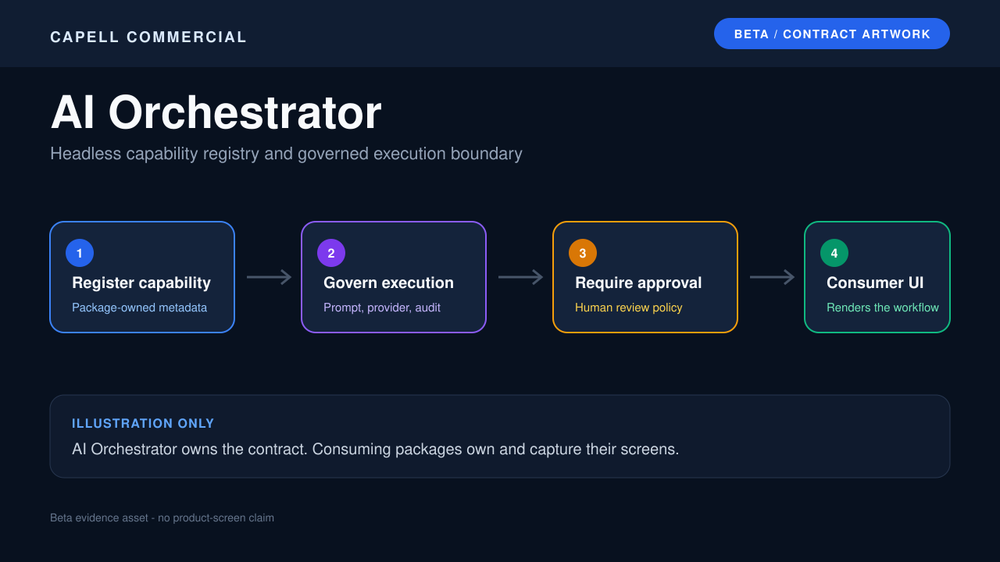

# AI Orchestrator

<!-- prettier-ignore-start -->

## What It Does

AI Orchestrator provides a shared capability registry, governed execution path, generation history, and request queue for AI features owned by other Capell packages.

- **Price and availability:** Check current availability and price on the [Capell Marketplace listing](https://capell.app/extensions/ai-orchestrator).
- **Licence:** Check the licence terms on the [Capell Marketplace listing](https://capell.app/extensions/ai-orchestrator).
- **Requires:** `PHP ^8.4`, `capell-app/admin ^1.0`, `capell-app/core ^1.0.75`, `lorisleiva/laravel-actions ^2.8`, `prism-php/prism ^0.100`, `spatie/laravel-data ^4.5`, `spatie/laravel-package-tools ^1.14.1`.
- **Install:** `composer require capell-app/ai-orchestrator`.

Admins can inspect registered capability metadata in the capability catalogue. Consuming packages keep ownership of their editor actions and approval screens.

## Who It Is For

**For developers:** Packages implement AIOrchestratorModule and register typed capabilities, while RunAIOrchestratorCapabilityAction enforces runnable actions, authorisation, and policy guardrails in one place.

**For teams:** AI-assisted features across Capell share the same registration, approval, execution, and recording boundaries instead of behaving differently in each package.

## Quick Start

1. Install the package: `composer require capell-app/ai-orchestrator`.
2. Open the package admin page or resource and verify AI Orchestrator is available.

## Configure

- **Configuration files:** `config/capell-ai-orchestrator.php`.
- **Admin settings:** `Capell\AIOrchestrator\Settings\AIOrchestratorSettings`.
- **Commands:** `php artisan capell:ai-orchestrator:prune-generation-payloads`.

## Limits And Pitfalls

- Install the required Capell packages at the versions in `composer.json`: `capell-app/admin ^1.0`, `capell-app/core ^1.0.75`.
- Run migrations before opening package resources or public routes.
- Keep the host Laravel scheduler running so package-registered schedules can execute: `capell:ai-orchestrator:prune-generation-payloads (daily; package registered)`.

## Screens And Workflow

- AI Orchestrator beta contract artwork (marketplace).

## Install Impact

- Required packages: `capell-app/admin`, `capell-app/core`.
- Admin navigation: declares `admin-page: AiOrchestratorAdminPageContribution`; each Filament page or resource controls its own navigation visibility.
- Admin/editor extensions: none declared.
- Permissions: no package permission declarations or Shield gates detected; host access rules still apply.
- Public routes: none declared.
- Database changes: package migrations are declared.
- Config: `config/capell-ai-orchestrator.php`.
- Settings: `Capell\AIOrchestrator\Settings\AIOrchestratorSettings`.
- Queues or schedules: scheduled commands `capell:ai-orchestrator:prune-generation-payloads (daily; package registered)`; queue jobs `RunAiAssistantGenerationJob`.
- Cache tags: none declared.
- Commands: `capell:ai-orchestrator:prune-generation-payloads`.

## Troubleshooting

| Symptom | Likely cause | Check | Fix |
| --- | --- | --- | --- |
| Package surface is missing after install | Provider or manifest is not loaded | Confirm `capell.json`, package `composer.json`, and provider registration | Reinstall the package, refresh Composer autoload, and clear host caches |
| Admin screen or command fails on missing table | Package migrations have not run | Check the tables listed in `Data Model` | Run host migrations and rerun the focused package test |
| Background work does not run | Queue worker or declared schedule is not active | Check the jobs and scheduled commands listed in `Technical Shape` | Start the queue worker or host scheduler, then run the focused command or package test |

## Upgrading

Read [CHANGELOG.md](CHANGELOG.md) before upgrading.

### Unreleased: 2.0 migration

- Remove calls to `AiSpendGuard`, `AiSpendReservationData`, `AssertAiModelPriceConfiguredAction`, `AssertAiRequestBudgetAction`, and `EstimateAiGenerationCostAction`.
- Move financial authorisation and settlement to the consuming application. Pass only caller-issued execution allowances and opaque `reservation_reference` evidence to managed provider calls.
- Stop treating legacy `ai_generation_histories.cost_micros` and `cost_currency` columns as live producer-owned cost authority. They remain in historical schemas only for upgrade compatibility.

- Prepared package metadata and documentation for ongoing Capell 0.0.x package work.

## Next Steps

- [Package docs](docs/README.md)
- [Overview](docs/overview.md)
- [Worked extension examples](docs/extension-contracts.md)
- Configuration files: [`config/capell-ai-orchestrator.php`](config/capell-ai-orchestrator.php).
- [Troubleshooting](#troubleshooting)
- [Developer reference](docs/reference.md)
- [Marketplace assets](docs/assets/marketplace/)
- [Capell content language plan](../../docs/CONTENT_LANGUAGE_PLAN.md)
- [Capell documentation design system](../../docs/DESIGN_SYSTEM.md)
- [Capell and package ERD notes](../../docs/erd/capell-and-package-erds.md)
- Related packages: [AI Creator](../ai-creator/README.md), [Content Sections](../content-sections/README.md), [Layout Builder](../layout-builder/README.md), [Media AI](../media-ai/README.md), [SEO Suite](../seo-suite/README.md), [Translation Manager](../translation-manager/README.md).

<!-- prettier-ignore-end -->
